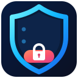

# 🛡️ ScrollSentinel



**Take control of your scroll.** A distraction-control and cybersecurity-learning Firefox extension.

ScrollSentinel currently protects **YouTube only**, combining scheduled access, an estimated daily browsing-time limit, 7- or 14-day Strict Mode, and a Distraction-Free YouTube view with 30-minute cybersecurity quests. It is open source and stores its settings locally.

> **Project status:** Development prototype (v2.5.1), newly renamed from **YouTube Focus Hours**. The code is on GitHub, but **no Mozilla-signed public or unlisted release has been published yet**. See [Installation](#-installation) for what works now and how permanent installation will work after signing.

## 🌍 Supported platforms — current vs planned

| Website | Current support | Planned direction |
| --- | --- | --- |
| **YouTube** | ✅ Working development implementation: timed access, daily browsing budget, distraction-free UI, cybersecurity quests | Improve testing and reliability |
| **Facebook / Reels / Videos** | ⏳ **Not implemented** | Optional selective blocking for Reels/video views, with site-specific settings |
| **Instagram / Reels** | ⏳ **Not implemented** | Optional website/short-form-video restrictions |
| **TikTok** | ⏳ **Not implemented** | Scheduled site blocking and time budgeting |

**Important:** Renaming this extension does **not** extend its permissions or blocking features to other websites. Facebook, Instagram and TikTok are future work only.

**Brand identity:** The ScrollSentinel shield surrounds scrolling-feed lines and a lock, symbolizing focused browsing without tying the icon to a particular social platform. The add-on keeps its original internal Firefox extension ID for compatibility.

**v2.5.1 artwork fix:** The Least Privilege padlock is now positioned above the DATA card, keeping both its title and description visible. An automated regression check protects against the overlap returning.

## 🎬 Cybersecurity Learning Stories (12 animated quests)

ScrollSentinel now presents a **short, illustrated cybersecurity story for every quest** while YouTube is blocked. Each story has characters or security objects, several timed steps, and a successful learning outcome.

| # | Quest | Animated story |
| --- | --- | --- |
| 1 | 🌐 DNS / HTTPS Networking | One person connects with **four others** (DNS, IP, TLS, HTTPS). Each link activates; all five celebrate **4/4 connected**. |
| 2 | 📡 TCP / UDP | A sender delivers packets over two routes. TCP shows acknowledgment; UDP demonstrates a fast send. |
| 3 | 🗝️ Least Privilege | An employee's admin request is denied, but a read-only request is granted. |
| 4 | 🛠️ Patch Management | An engineer applies a security patch to an at-risk server, then the server becomes protected. |
| 5 | 🔐 Password Hashing | A password combines with a unique salt, becomes a hash, and is stored securely. |
| 6 | 📱 Multi-Factor Authentication | The first factor is checked, then a phone code; only after both does access succeed. |
| 7 | 🛡️ Zero Trust | Identity and device security are verified before a protected service grants access. |
| 8 | 🐧 Linux File Permissions | A Linux user inspects file permissions, executes `chmod 600`, and verifies the restrictive result. |
| 9 | 🎯 Threat Modeling | An analyst identifies a vulnerable asset and incoming threat, then applies a mitigation. |
| 10 | 🎣 Phishing Detection | A suspicious email arrives. The user checks the sender, recognizes the attempt, and reports/removes it without clicking. |
| 11 | 🔺 CIA Triad | Confidentiality, Integrity, and Availability appear in sequence to protect an asset. |
| 12 | 💻 Ethical Security | A researcher confirms authorization, enters a test lab, and completes a safe, scoped security exercise. |

### ⏲️ Timing and distraction control

- **Every 30 minutes:** The learning **quest changes** at fixed local clock slots (:00 and :30). Refreshing the page does not unlock the next quest.
- **Every 5 minutes:** While its quest remains active on a visible blocked YouTube tab, the **same story replays** from the beginning; the educational message does not change.
- **Story length:** Approximately 8–10 seconds; the completed scene stays still between replays.
- **Motion accessibility:** With `prefers-reduced-motion`, scenes show their finished, informative state without animation.
- **Performance/privacy:** The visuals use built-in SVG, CSS, and local JavaScript; no analytics, remote fonts, images, or animation service.

Stories are educational analogies, **not precise simulations of networking protocols**. For instance, the four people in the DNS/HTTPS quest symbolize connected endpoints.

## ✨ Features and what they do

| Feature | What it does | Important details |
| --- | --- | --- |
| ⏰ **Scheduled YouTube Access** | Allows YouTube only during the daily time windows you set and shows a blocking screen outside them. | Defaults: **12:00 PM–2:00 PM** and **10:00 PM–11:30 PM**, local computer time. Two windows are supported in the current popup. |
| 🚫 **Automatic YouTube Blocker** | Covers YouTube pages with a blocking overlay whenever access is not allowed. | Applies to matching YouTube browser pages; **not** a system-wide block, and it does not block other browsers or apps. |
| ⏳ **Daily Time Budget** | Stops access after your daily allowance is used, even during an allowed window. | Default: **90 minutes/day**; configurable between 1 and 1440 minutes. |
| 📈 **Approximate Usage Tracking** | Displays today's estimated minutes used versus the daily limit. | Counts activity reported by a **focused, visible YouTube tab**. It is **not** exact video playback time; behavior with multiple tabs and background audio can vary. |
| 🌙 **Daily Reset** | Starts a new time budget on a new calendar day. | Uses the device's **local date**, resetting on the first check after local midnight. |
| 🔒 **Strict Mode (7 or 14 days)** | Locks the extension's settings until the lock period ends. | Choose a duration **before** pressing Save. During the lock, settings controls are disabled and the background script rejects changes. |
| 🧠 **Distraction-Free YouTube** | Hides several distracting parts of YouTube while browsing is permitted. | Can be enabled/disabled when settings are unlocked; YouTube interface updates can affect filtering. |
| 🏠 **Hide Homepage Recommendations** | Attempts to hide the rich recommendation grid on the YouTube homepage. | Removes selected page elements from view, not from YouTube's servers. |
| 🎥 **Hide Suggested Videos** | Hides the watch-page suggestion sidebar and certain compact video items. | Direct links, searches and video playback remain available during allowed hours. |
| 💬 **Hide Comments** | Hides the YouTube comments section. | A display-level filter. |
| 📱 **Reduce Shorts Distractions** | Hides selected Shorts shelves and Shorts navigation links. | **Does not comprehensively block every direct Shorts URL** in this version. |
| 🔔 **Hide YouTube Notification Button** | Hides the corresponding YouTube toolbar element. | Does not change YouTube account notifications or Firefox notification permissions. |
| ▶️ **Autoplay Reduction** | Attempts to turn off YouTube's next-video autoplay toggle. | **Best effort**; may not work after all YouTube layout changes. |
| 🧠 **Quest-First Cybersecurity Learning** | The current cybersecurity topic takes center stage with a short illustrated learning story. | New quest every 30 minutes; no manual skip button. |
| 🌌 **Quest-Specific Animated Stories** | All 12 challenges have separate step-by-step visual stories and topic-matched backgrounds. | Each story replays every 5 minutes when its blocked tab is visible; respects reduced-motion preferences. |
| 📐 **Responsive Blocking Screen** | Adjusts art, typography, spacing and content placement for narrow or short Firefox windows. | On extremely small windows, page scrolling remains available; respects reduced-motion preferences. |
| 🎨 **Cybersecurity Training Screen** | Replaces the older cartoon guard with a cybersecurity-focused visual display and understated access countdown. | When the daily budget is exhausted, the access panel displays **TOMORROW**. |
| 🛡️ **ScrollSentinel Shield Icon** | A shield surrounding stylized scrolling feed lines and a lock identifies the extension in Firefox without using another platform's branding. | Lightweight SVG asset in `icons/scrollsentinel.svg`. |
| 🧩 **Firefox Toolbar Popup** | Shows access status, time used, viewing windows, daily limit, filter switch and Strict Mode controls. | Settings are saved with **Save settings**. |
| 🔐 **Local-Only Settings** | Stores the schedule, lock expiration and estimated usage in Firefox's extension storage. | No external analytics server is used by the extension. |

### Example daily schedule

| Local time | YouTube |
| --- | --- |
| 12:00 AM–12:00 PM | 🔴 Blocked |
| 12:00 PM–2:00 PM | 🟢 Allowed **if daily budget remains** |
| 2:00 PM–10:00 PM | 🔴 Blocked |
| 10:00 PM–11:30 PM | 🟢 Allowed **if daily budget remains** |
| 11:30 PM–12:00 AM | 🔴 Blocked |

The allowed windows total **3 hours 30 minutes**, but the default **90-minute daily budget** can end access earlier. Both conditions must be satisfied for YouTube to be accessible.

### Strict Mode is not tamper-proof

Strict Mode prevents changes **through this extension's interface** until the chosen time expires. It **cannot** prevent you from disabling/uninstalling the add-on in Firefox, deleting its stored data, using another Firefox profile/browser, changing the computer clock, or editing local source code. It is a self-discipline aid, **not an anti-uninstall or parental-control security guarantee**.

## 🦊 Installation

### Option A — Temporary installation (available now; best for testing)

**Requirements:** Desktop Firefox and a downloaded copy of the repository. No Mozilla account or signing required.

1. Open this repository: [github.com/Sayeed843/scrollsentinel](https://github.com/Sayeed843/scrollsentinel).
2. Click **Code → Download ZIP** and **extract** the ZIP, or clone it:
   ```bash
   git clone https://github.com/Sayeed843/scrollsentinel.git
   cd scrollsentinel
   ```
3. In Firefox, enter **`about:debugging#/runtime/this-firefox`** in the address bar.
4. Click **Load Temporary Add-on…**.
5. Select the extracted project's **`manifest.json`** file.
6. Open the **Extensions** (puzzle-piece) menu, choose **ScrollSentinel**, adjust your settings, and click **Save settings**.

**Reminder:** Temporary add-ons are unloaded when you **restart Firefox**. To test again, repeat steps 3–5. In `about:debugging`, use **Reload** after you edit the extension's source files.

**Mozilla reference:** [Temporary installation in Firefox](https://extensionworkshop.com/documentation/develop/temporary-installation-in-firefox/).

### Option B — Permanent installation from Mozilla Add-ons (when published)

**This option is not available for this project yet.** After the extension passes Mozilla's submission/review process and receives a **public listing**, users will be able to:

1. Open its official **addons.mozilla.org** listing.
2. Click **Add to Firefox**.
3. Review the permissions and click **Add**.
4. Open the extension's toolbar popup and configure it.

A listed, signed extension remains installed across Firefox restarts; approved updates are distributed through Mozilla Add-ons. **There is no official listing link for this project at present.**

**Mozilla reference:** [Signing and distributing add-ons](https://extensionworkshop.com/documentation/publish/signing-and-distribution-overview/).

### Option C — Permanent installation using a signed XPI (self-distribution, when available)

A developer may submit an add-on for **unlisted/self-distribution** signing instead of a public store listing. Once a **Mozilla-signed `.xpi`** has actually been released:

1. Download the **signed** `.xpi` from the developer's official release location.
2. Open **`about:addons`** in desktop Firefox.
3. Click the **gear icon → Install Add-on From File…**.
4. Select the signed `.xpi` and approve the permission prompt.

This installation persists after Firefox restarts. **An unsigned ZIP or an XPI made by simply renaming a ZIP will not permanently install in standard Firefox.** Self-distributed versions need a separately configured update path or users must install newer signed versions manually.

**Mozilla references:** [Self-distribution](https://extensionworkshop.com/documentation/publish/self-distribution/) · [Add-on signing](https://support.mozilla.org/en-US/kb/add-on-signing-in-firefox).

### For developers: validate and package

With Node.js/npm installed, from the repository directory:

```bash
npm install --global web-ext
web-ext lint
web-ext build
```

`web-ext build` creates a **package for submission/testing**, **not a signed permanent-install file**. Mozilla signing and any required validation/review are still necessary.

## ⚙️ Settings quick start

1. Toggle **Enable blocking** on.
2. Set the first and second allowed viewing windows (or leave the defaults).
3. Choose the **daily minute limit** (default: 90).
4. Enable **Distraction-Free YouTube** if you want to reduce recommendations, comments and suggested videos.
5. For Strict Mode, choose **No lock**, **7 days**, or **14 days**.
6. Click **Save settings**. A 7- or 14-day lock requires confirmation and then prevents editing settings inside the popup until it expires.

**Tip:** Test your schedule **without** Strict Mode first. Strict Mode cannot be reversed through the popup before expiry.

## 📁 Project structure

```text
scrollsentinel/
├── manifest.json    # ScrollSentinel metadata and permissions
├── background.js    # Time windows, usage budget, local state and Strict Mode
├── quest-stories.js # 11 illustrated story scenes; Networking lives in guard.js
├── guard.js         # YouTube overlay, 30-minute quests, 5-minute story replays
├── popup.html       # Popup user interface
├── icons/
│   └── scrollsentinel.svg # Shield + scroll + lock icon
├── popup.js         # Popup behavior and settings management
├── tests/
│   └── quest-stories.test.cjs # Dependency-free story and timing checks
├── .github/workflows/
│   └── quality.yml  # Automated GitHub Actions checks
├── README.md        # Documentation
├── LICENSE          # MIT license
└── .gitignore       # Ignored build artifacts
```

## 🧪 Automated quality checks

GitHub Actions validates JavaScript syntax and runs the dependency-free Node test suite on pushes and pull requests.

[](https://github.com/Sayeed843/scrollsentinel/actions/workflows/quality.yml)

To run the same story tests locally (requires Node.js):

```bash
node --test tests/quest-stories.test.cjs
```

**These are source-level tests, not a substitute for testing the extension in a live Firefox session.**

## 🔍 Known limitations & testing

This is an **early development version**, **not** a verified Mozilla Add-ons release. Automated JavaScript story checks are provided in `tests/quest-stories.test.cjs` (run with `node --test tests/quest-stories.test.cjs`), but **full Firefox/browser acceptance testing has not been completed**. Before relying on it, please test:

- Time transitions at **12:00**, **14:00**, **22:00**, and **23:30** in your local time zone.
- Budget consumption and blocking when the 90-minute limit is reached.
- Reset on the next local calendar day.
- Strict Mode lock behavior, expiry, and Firefox restart behavior (using a signed install when available).
- Multiple tabs, window focus, background audio/video and single-page YouTube navigation.
- Whether the YouTube filters still work after interface updates.
- All 12 visual stories at narrow and short viewport sizes, five-minute replay timing, reduced-motion preference, and tab visibility changes.

YouTube may change HTML selectors; the filters and autoplay reduction are best effort. The blocker is a **page overlay**; it does not block mobile YouTube apps or network traffic.

## 🛡️ Privacy

Settings, lock information and approximate usage counters are stored **locally** in Firefox extension storage. This project does not implement user accounts, remote telemetry or an analytics backend. YouTube itself may still collect data when you browse its service. Review the code and permissions before installing.

## 🤖 AI assistance acknowledgment

**This project was planned and developed with the assistance of ChatGPT by OpenAI.** ChatGPT helped design and generate the extension code, feature behavior and documentation. The repository owner is responsible for reviewing, testing, maintaining and publishing the software. AI-generated code may contain mistakes.

## 📄 License

Released under the **MIT License**. See [LICENSE](LICENSE).

---

**GitHub repository:** The official project repository is [Sayeed843/scrollsentinel](https://github.com/Sayeed843/scrollsentinel).

**Source code:** [Sayeed843/scrollsentinel](https://github.com/Sayeed843/scrollsentinel) · **Issues and feedback:** [GitHub Issues](https://github.com/Sayeed843/scrollsentinel/issues)
